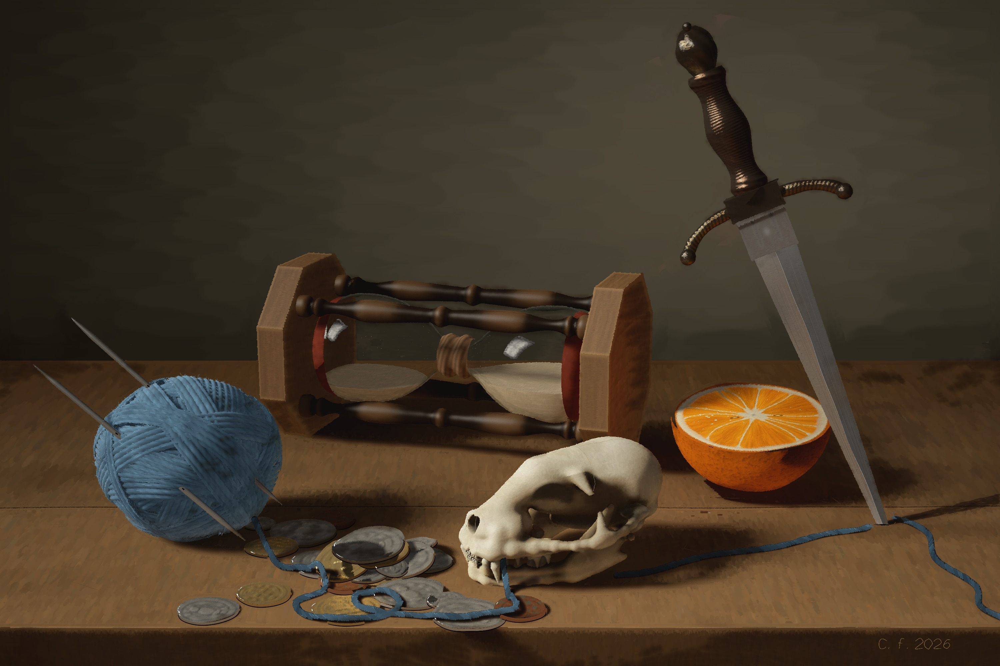

# The Cut Thread

A still life painted stroke by stroke in code: a cat's skull, an hourglass, a ball of yarn with
its needles, a heap of mixed coins, half an orange, and a dagger driven into the table.



A time-lapse of the painting being made is in [`out/timelapse.gif`](out/timelapse.gif)
(and, sharper, [`out/timelapse.mp4`](out/timelapse.mp4)).

## The rules it was made under

- No image model, and no renderer. Nothing is ray-traced or rasterised ahead of time and then copied.
- Every mark on the canvas is a brush stroke laid through a simulated oil-paint engine.
- The objects are drawn the way a draughtsman constructs them: in perspective, from measured
  cross-sections, with cast shadows found by following the light. Each stroke then asks one
  question of that construction before it is laid: "this bit of surface faces that way, in this
  light; what colour do I mix?"

Reference photographs (cat skulls, hourglasses, cut oranges, yarn, old coins, and Pieter Claesz's
vanitas paintings) were looked at for study, from Wikimedia Commons and Openverse. None was traced
and none is included here.

## What is in the picture

The three Fates of Greek myth spin the thread of a life, measure it, and cut it. Here the yarn
is spun, the hourglass measures, and the blade has come down through the strand where it crosses
the table. The cat's skull faces the ball of yarn it once played with. Nine of the coins in the
heap are gold. The orange is the one warm, living colour, and it is already half gone.

## How it works

| Part | What it does |
|---|---|
| `engine/paint.cpp` | The paint. A canvas with a dry layer and a wet film; brushes that lay paint down and pick it up; Kubelka-Munk optics, so thin paint is translucent and thick paint covers. |
| `atelier/` | The drawing toolkit: perspective and constructed shadows (`geom.py`), the light of the scene (`shading.py`), solid and free forms (`forms.py`), outlines (`stencil.py`), and ways of covering a form with strokes (`brushwork.py`). |
| `still_life/` | The picture: the set-up (`scene.py`), wall and table (`setting.py`), one file per object, and `paint.py`, which paints everything from far to near. |
| `studies/` | The first studies: engine tests, a ball on a table, the compositional block-in, the skull's construction. |
| `tools/timelapse.py` | Turns the frames recorded during painting into the GIF and MP4. |

## Painting it again

```bash
sh engine/build.sh
```

```bash
python3 -m still_life.paint --out out/still_life.png --frames frames
```

```bash
python3 tools/timelapse.py frames out/still_life.png out/timelapse
```

It needs a C++ compiler, Python 3 with NumPy and Pillow, and `ffmpeg` for the time-lapse. The full
canvas is 3000 x 2000 pixels and takes roughly a quarter of an hour on four cores.

To work on one object, paint it alone in a window of the canvas:

```bash
python3 -m still_life.paint --only skull --out studies/out/skull.png
```
